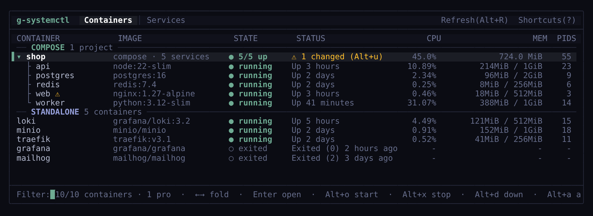

# g-systemctl


[](LICENSE)

A terminal UI for Docker containers and system services (systemctl on Linux, launchctl on macOS).



## Features

- Containers: live CPU/memory/PIDs, start/stop/restart, logs, inspect, change resource limits in place
- Docker Compose: containers grouped by project; start/stop/restart, `up -d`, build, pull, down; flags changed compose files
- Services: list, filter, start/stop/restart, follow `journalctl` logs, edit unit files
- Detail page with summary, graphs and live logs
- Keyboard and mouse

## Install

Debian / Ubuntu (22.04+ / 12+), use `arm64` instead of `amd64` for ARM:

```bash
curl -LO https://github.com/shakg/g-systemctl/releases/latest/download/g-systemctl-linux-amd64.deb
sudo apt install ./g-systemctl-linux-amd64.deb
```

Other Linux (glibc 2.34+):

```bash
curl -LO https://github.com/shakg/g-systemctl/releases/latest/download/g-systemctl-linux-$(uname -m).tar.gz
tar -xzf g-systemctl-linux-$(uname -m).tar.gz
sudo install -m 755 g-systemctl-*/g-systemctl /usr/local/bin/g-systemctl
```

macOS:

```bash
curl -LO https://github.com/shakg/g-systemctl/releases/latest/download/g-systemctl.rb
brew install ./g-systemctl.rb
```

From source (CMake 3.14+, C++17 compiler):

```bash
git clone https://github.com/shakg/g-systemctl.git
cd g-systemctl && mkdir build && cd build
cmake -DCMAKE_BUILD_TYPE=Release .. && make -j$(nproc)
sudo make install
```

## Usage

```bash
g-systemctl              # Containers tab, or Services if Docker is unavailable
g-systemctl -s           # Services tab
g-systemctl -c           # Containers tab
g-systemctl --user       # User services
g-systemctl -f nginx     # Start with a filter
```

Starting and stopping services needs root; run with `sudo` or enter the password when asked.

| Key | Action |
|-----|--------|
| Type | Filter |
| `Up` / `Down` | Move |
| `Enter` / `Esc` | Open / back |
| `Alt+o` / `Alt+x` / `Alt+r` | Start / stop / restart (stop and restart ask y/n) |
| `Alt+1` / `Alt+2` | Containers / Services tab |
| `?` | All shortcuts |
| `Alt+q` | Quit |

## Contributing

See [CONTRIBUTING.md](docs/CONTRIBUTING.md).

## License

[MIT](LICENSE)
